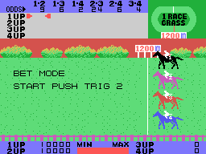
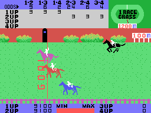

# The bets

In modes B to E, from one to four players bet on the **pair** of horses that finish first and
second, in either order: 1-2, 1-3, 1-4, 2-3, 2-4 or 3-4. Each player starts with 100 points,
shown with two zeros behind (10000) at the bottom of the screen, next to 1UP, 2UP, 3UP and 4UP.

## The odds

Before each race the game draws sixteen numbers from 0 to 15, four per horse (`azar16`,
0xA97E). With the first number of each horse it makes the **odds** of the six pairs, in the
ODDS row at the top (`cuotas`, 0xA1B9):

- the **weight** of a pair is 31 minus the numbers of its two horses, squared;
- each odds is the pair's weight times a factor, divided by the sum of the six weights, and
  never less than 2. The factor grows with the gap between the highest and the lowest number
  (0xA2EF).

The same first number goes into the horse's **strength** for the race, together with the
distance and the second number (`fuerzas_empieza`, 0xA01C). So the stronger the two horses,
the less their pair pays.

## How to bet

BET MODE: a red cursor of two sprites moves over a grid of six columns, one per pair, and a
row per player (`apuesta_mueve`, 0xA49A). Button 1 switches between **moving** and
**betting**; while betting the cursor blinks, and each push up puts one point on the pair and
each push down takes it back; held down, it repeats (`apuesta_punto`, 0xA400). Each player can
bet on up to **three pairs**, up to 99 points each. Button 2 ends the bets and the race starts.

In the GIF, player 1 bets three points on 1-2, 1-3 and 1-4, and player 2 on 2-3, 2-4 and 3-4.

## The payout

When the first two horses cross the line, the winning pair blinks in the ODDS row
(`ganadora_parpadea`, 0xA992) and the payout starts. It does not run in the interrupt but in
the main loop (`pago`, 0xA2F5): for each point bet on the winning pair, the odds are added to
the player's money, one point at a time, and the money is written on the screen each time. In
the GIF the pair is 2-3, at 24: player 2 had three points on it and goes from 9100 to 16300.

If nobody has any money left, GAME OVER; after race 9, RACE END. Otherwise, PUSH TRIG 2 and
the next race.

In the jockey mode the money of 1UP is the prize: 1ST BONUS or 2ND BONUS if the player's horse
finishes first or second (`premio_jinete`, 0xABCC).
