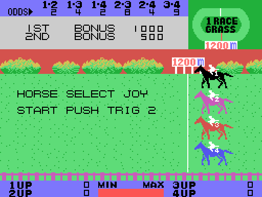

# The game

*Exciting Jockey* is a steeplechase (the Japanese title, 大障害競馬, means "the great
steeplechase"): four horses run nine races on grass or on dirt, from 1200 to 3600 metres,
over fences, water jumps and shrubs. The player either **rides** one of the four horses or
**bets** on how they finish. The screen is the track seen from the side, scrolling while the
horses run to the left; above it, the odds, a box with the bonuses or the bets, and an oval
with the name of the race. The races are in [The races](THE-RACES.html), the bets in
[The bets](THE-BETS.html).

Every GIF on this site is the ROM **running in openMSX** (a Japanese MSX1, at 60 frames per
second): on every frame the VRAM and the VDP registers are logged, and `tools/vdp.py` paints
them.

## The five modes

| | mode | what the player does |
|---|---|---|
| A | PLAY-JOCKEY MODE | rides a horse |
| B | 1PLAYER BET MODE | one player bets |
| C | 2PLAYERS BET MODE | two players bet |
| D | 3PLAYERS BET MODE | three players bet |
| E | 4PLAYERS BET MODE | four players bet |

The joystick moves the cursor and button 1 starts (`seleccion_elige`, 0x86E5). If nobody
touches anything for 1024 frames (about 17 seconds), the **demonstration** starts: race 9,
the longest, run by the computer with DEMONSTRATION blinking in the box.

## The controls

There is one joystick for everyone: the game reads joystick 1, then joystick 2, then the
cursor keys (`mandos`, 0x9469).

| | joystick | keyboard |
|---|---|---|
| direction | joystick 1 or 2 | the cursor keys |
| button 1 | button A | the space bar |
| button 2 | button B | GRAPH |

## The jockey

In mode A the player picks a horse with the joystick and button 1 (HORSE SELECT), and
button 2 starts the race. During the race:

- **button 2 jumps** (`corre`, 0x97A2). The jump goes up, hangs for 24 frames and comes
  down; where it lands decides what happens (`salto_baja`, 0x9BD8);
- **button 1 is the whip** (`latigo_pulsa`, 0xAB27). Each stroke waits 32 frames in a queue
  of up to 16, and then the horse goes one step faster, up to five steps (from speed 0x60 to
  0x84). After a while without the whip, it slows down one step at a time
  (`velocidad_jugador`, 0xAA2F). Whipping at the top speed **tires** the horse: it loses
  strength (`latigo_cansa`, 0xAAB0);
- **up and down** move the horse up to four pixels out of its lane (`calle`, 0x99C4).

The **MIN-MAX** bar at the bottom is what is left of the horse's strength, from 0 to 63
(`barra_cuenta`, 0xAB99). Each horse spends strength as it runs, more the faster it goes
(`cansancio`, 0x96A1); with none left, the horse falls to the slowest speed.

The prizes of each race are in the box: 1ST BONUS and 2ND BONUS, from 1000 and 500 in race 1
to 9000 and 4500 in race 9 (0xAC01). If the player's horse finishes **last**, GAME OVER
(`carrera_final`, 0x8BA0); otherwise the next race. After race 9, RACE END and back to race 1.

## The horses of the computer

The computer does not press buttons: its horses **jump on their own** when what is 16
pixels ahead is an obstacle (`corre_ordenador`, 0x97BF). Every step of the track it chooses
the pace of each horse from the strength it has left and the distance still to run
(`fuerzas`, 0x9F4A), and every four steps it whips at random, one time in four
(`carrera_ordenador`, 0xA571).

## What a horse can hit

The game reads the tile under the horse's feet straight from the VRAM name table
(`pisa`, 0x98B4):

| what it steps on | what happens |
|---|---|
| a **shrub** | it stumbles: 24 frames slowed down, and it runs on (`caballo_tropieza`, 0x9B26) |
| a **fence** or the **water** | it falls: the jockey is thrown, the horse lies down and the track carries it backwards; when it reaches the right edge, the jockey gets back on and it runs again (`caballo_cae`, 0x9C12) |
| the **finish line** | it arrives (`caballo_meta`, 0x97E0) |

A jump that lands on a shrub is a stumble, and one that lands on a fence or in the water is
a fall.

## The nine races

| race | ground | distance | fences | water jumps | shrubs |
|---:|---|---:|---:|---:|---|
| 1 | grass | 1200 m | | | |
| 2 | dirt | 1600 m | 2 | 2 | yes |
| 3 | grass | 2400 m | 4 | 4 | |
| 4 | grass | 1600 m | | | yes |
| 5 | dirt | 2400 m | 7 | 7 | |
| 6 | grass | 1600 m | 5 | 5 | yes |
| 7 | grass | 2400 m | | | |
| 8 | dirt | 3200 m | 11 | 9 | yes |
| 9 | dirt | 3600 m | 10 | 10 | |

Each race is a byte (0x8DA3): grass or dirt, one of seven series of obstacles and one of
five distances. The track is counted in steps of 25 metres (48 steps the 1200 m). The fences
and water jumps come from the series (0x8E5A), always in the same places; the **shrubs** are
put at random, two at a time, and only in the even races (`obstaculo_matas`, 0x9258).
