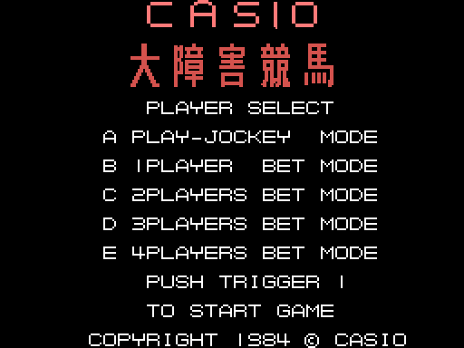
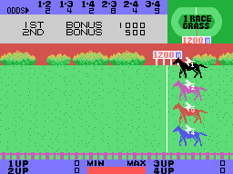
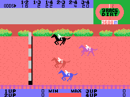
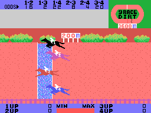
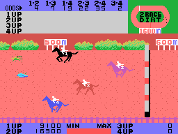
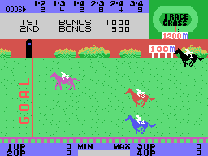

# The races

## The selection

The game puts SCREEN 2 together by hand, with the eight VDP registers of 0x8053, and loads
all its drawings at once (`carga_dibujos`, 0x83F6): 2 KB of sprites, 2 KB of tiles and their
colours. The selection is assembled in RAM when the game starts (`seleccion_monta`, 0x84AA):
CASIO and 大障害競馬 in big letters, the five modes and the copyright.

This screen comes from **running the ROM** with `tools/pantallas.py` (the Z80 of
`tools/z80run.py` with the BIOS routines the game uses, written by hand in `tools/bios.py`),
and it is identical to the VRAM recorded by openMSX: **0 different pixels** out of 49,152.
The race screen above, in [The game](THE-GAME.html), is a frame recorded in openMSX: the
ground and the odds are drawn at random with the Z80's R register (`azar`, 0x8636), so no
two races look the same.

## The track

The track is twelve rows of ground with tiles chosen at random (`suelo_azar`, 0x901C), a row
of shrubs and distance signs on top and a fence at the bottom. It is kept in RAM (0xED00) and
**scrolls a whole tile to the right** (eight pixels) each time its count (0xE06F) passes 16:
everything moves one byte and a new column comes in on the left with its shrubs and its obstacle
(`pista_corre`, 0x90F9). Every five columns is a step of 25 metres.

The track goes **at the speed of the leading horse**: when a horse reaches the left edge of
the screen, the track takes its speed, and then it slows down little by little
(`camara`, 0x9627). Each horse moves on the screen by the difference between its speed and
the track's.

In the oval at the top right, **four dots** go round with the horses (`plano`, 0xA6E3): the
two straights and the two bends are tables of coordinates (0xA7BC).

## The start

The fanfare, the starting sound, and the horses go (`carrera_sale`, 0x8B0B). While they run,
channel 0 of the sound engine plays the **gallop**: three beats of noise that repeat with no end.

## The jump

The jump is a series of drawings of the horse (0x9A20): it goes up, it hangs for 24 frames
and it comes down (`caballo_salta`, 0x9B98). The jockey is a sprite of its own, with the
horse's number, and follows the gallop up and down.

## The fall

A horse that steps into the water or on a fence **falls**: at the fourth step of the fall
its jockey flies off along an eight-point path (0x9E7F), the horse lies on the ground and the
track carries it backwards. At the right edge the jockey gets back on and the horse runs again
(`suelo_atras`, 0x9C87).

## The shrub

In the even races there are **shrubs** on the dirt, put at random two at a time. A horse that
steps on one **stumbles**: it slows down for 24 frames and runs on (`frenazo`, 0x9B4A).

## The finish

The finish post has GOAL written down it. The first horse to cross it changes all the others
to the last state, run until they are off the screen (`caballo_tras_meta`, 0x9CD3); the
light on top of the post turns white for eight frames at each arrival (`meta_luz`, 0x9EAD).
The first two make the **winning pair** (`meta_puesto`, 0x97F8): each horse adds a value
(0x10, 0x12, 0x14, 0x18) and the sum of the two gives the pair (0x9865). In the jockey mode
their numbers go into the box next to 1ST and 2ND.
