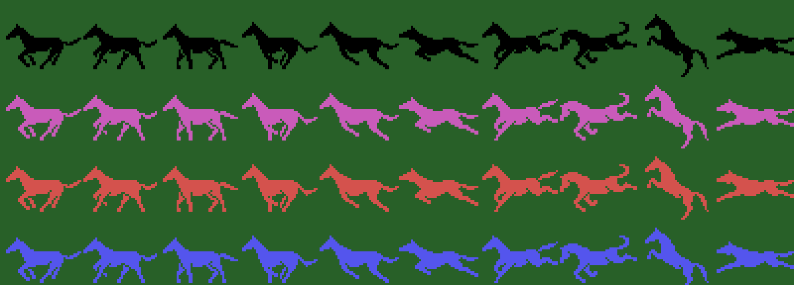

# The sprites

Everything on this page is **put together from the ROM tables** with `tools/hojas.py`. None of these images is a
screenshot.

**Checked against openMSX** on the recordings of this site: the sprite drawing table (VRAM 0x3800-0x3FFF) is
**identical** to the 2 KB at 0xAC1B on 44,335 frames (the other 5, while it loads), and the three sprites of each
horse match the game's copy of the sprite table on **62,625 frames**: on 62,465 with that frame's state, on 140 with
the previous one (the game builds the sprites and then changes the state), on 18 with the Y moved one dot after
building and on 2 halfway through a change of drawing.

## The horse

Ten three-sprite drawings (0xB3DB, nine bytes each: the drawing, the Y and the X of each sprite), in the colours of
the four horses (`caballos`, 0x970B: 1 black, 2 magenta, 3 dark red and 4 blue). The sprite drawings are the 2 KB at
0xAC1B, which `carga_dibujos` (0x8402) puts as they are at 0x3800.

## The animations

Four series of four drawings (0x9A20), which `tabla_umbral` (0x80BB) walks one drawing every 8 steps: the **gallop**
(2, 3, 0, 1), the **jump** (4, 5, 9, 6), the **fall** (8, 5, 7, 2) and **on the ground** (7, 2, 2, 2). The steps are
counted by `suma_paso` (0x80A3) with the horse's speed; here, with step 0x20 (speed 0x60 from the table at 0x961F),
one step every two frames and one drawing every 16: the gallop twice, the jump, the fall and on the ground.

## The jockey

White (0x9D49), with his horse's number, sitting or with the whip: the eight drawings at 0x9D99, which also hold his
place on the horse (unchecked: here they stand alone).

