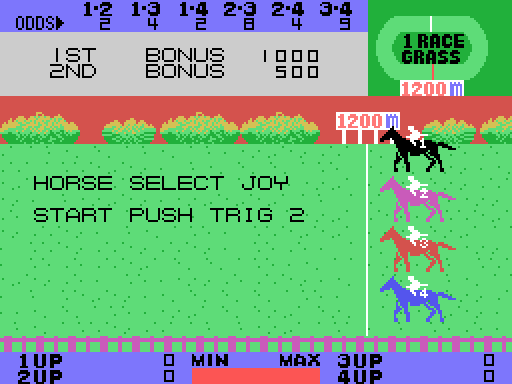

# La partida

*Exciting Jockey* son carreras de obstáculos (el título japonés, 大障害競馬, quiere decir «el
gran premio de obstáculos»): cuatro caballos corren nueve carreras en hierba o en tierra, de
1200 a 3600 metros, con vallas, rías y matas. El jugador **lleva** uno de los cuatro caballos o
**apuesta** a cómo llegan. La pantalla es la pista vista de lado, que corre mientras los
caballos van hacia la izquierda; encima, las cuotas, un recuadro con los premios o las
apuestas y un óvalo con el nombre de la carrera. Las carreras están en
[Las carreras](LAS-CARRERAS.html), y las apuestas en [Las apuestas](LAS-APUESTAS.html).

Todos los GIF de esta web son la ROM **funcionando en openMSX** (un MSX1 japonés, a 60
cuadros por segundo): en cada cuadro se apuntan la VRAM y los registros del VDP, y
`tools/vdp.py` los pinta.

## Los cinco modos

| | modo | qué hace el jugador |
|---|---|---|
| A | PLAY-JOCKEY MODE | lleva un caballo |
| B | 1PLAYER BET MODE | apuesta un jugador |
| C | 2PLAYERS BET MODE | apuestan dos |
| D | 3PLAYERS BET MODE | apuestan tres |
| E | 4PLAYERS BET MODE | apuestan cuatro |

La palanca mueve el cursor y el botón 1 empieza (`seleccion_elige`, 0x86E5). Si nadie toca
nada en 1024 cuadros (unos 17 segundos), empieza la **demostración**: la carrera 9, la más
larga, con el ordenador y DEMONSTRATION parpadeando en el recuadro.

## Los mandos

Hay un solo mando para todos: el juego lee el mando 1, luego el 2 y luego los cursores
(`mandos`, 0x9469).

| | mando | teclado |
|---|---|---|
| dirección | el mando 1 o el 2 | los cursores |
| botón 1 | el botón A | la barra espaciadora |
| botón 2 | el botón B | GRAPH |

## El jinete

En el modo A el jugador elige caballo con la palanca y el botón 1 (HORSE SELECT), y el botón
2 empieza la carrera. Durante la carrera:

- **el botón 2 salta** (`corre`, 0x97A2). El salto sube, se queda 24 cuadros en el aire y
  baja; dónde cae decide lo que pasa (`salto_baja`, 0x9BD8);
- **el botón 1 es el látigo** (`latigo_pulsa`, 0xAB27). Cada latigazo espera 32 cuadros en
  una cola de hasta 16, y después el caballo va un paso más rápido, hasta cinco pasos (de la
  velocidad 0x60 a la 0x84). Si pasa un rato sin látigo, se frena de paso en paso
  (`velocidad_jugador`, 0xAA2F). El látigo en la velocidad más alta **cansa** al caballo:
  pierde fuerza (`latigo_cansa`, 0xAAB0);
- **arriba y abajo** sacan al caballo hasta cuatro píxeles de su calle (`calle`, 0x99C4).

La barra **MIN-MAX** de abajo es lo que le queda de fuerza al caballo, de 0 a 63
(`barra_cuenta`, 0xAB99). Cada caballo gasta fuerza al correr, más cuanto más deprisa va
(`cansancio`, 0x96A1); sin fuerza, el caballo cae a la velocidad más lenta.

Los premios de cada carrera están en el recuadro: 1ST BONUS y 2ND BONUS, de 1000 y 500 en la
carrera 1 a 9000 y 4500 en la 9 (0xAC01). Si el caballo del jugador llega **el último**, GAME
OVER (`carrera_final`, 0x8BA0); si no, la carrera siguiente. Después de la 9, RACE END y otra
vez la 1.

## Los caballos del ordenador

El ordenador no pulsa botones: sus caballos **saltan solos** cuando lo que tienen 16 píxeles
por delante es un obstáculo (`corre_ordenador`, 0x97BF). En cada paso de la pista elige el
ritmo de cada caballo con la fuerza que le queda y lo que falta de carrera (`fuerzas`,
0x9F4A), y cada cuatro pasos usa el látigo al azar, una vez de cada cuatro
(`carrera_ordenador`, 0xA571).

## Con qué tropieza un caballo

El juego lee la casilla que hay bajo las patas del caballo directamente de la tabla de
nombres de la VRAM (`pisa`, 0x98B4):

| lo que pisa | lo que pasa |
|---|---|
| una **mata** | tropieza: 24 cuadros frenado, y sigue (`caballo_tropieza`, 0x9B26) |
| una **valla** o el **agua** | cae: el jinete sale despedido, el caballo se queda en el suelo y la pista lo lleva hacia atrás; al llegar al borde derecho, el jinete vuelve a montar y sigue (`caballo_cae`, 0x9C12) |
| la **meta** | llega (`caballo_meta`, 0x97E0) |

Un salto que cae sobre una mata es un tropiezo, y uno que cae en una valla o en el agua, una
caída.

## Las nueve carreras

| carrera | suelo | distancia | vallas | rías | matas |
|---:|---|---:|---:|---:|---|
| 1 | hierba | 1200 m | | | |
| 2 | tierra | 1600 m | 2 | 2 | sí |
| 3 | hierba | 2400 m | 4 | 4 | |
| 4 | hierba | 1600 m | | | sí |
| 5 | tierra | 2400 m | 7 | 7 | |
| 6 | hierba | 1600 m | 5 | 5 | sí |
| 7 | hierba | 2400 m | | | |
| 8 | tierra | 3200 m | 11 | 9 | sí |
| 9 | tierra | 3600 m | 10 | 10 | |

Cada carrera es un byte (0x8DA3): hierba o tierra, una de siete series de obstáculos y una
de cinco distancias. La pista se cuenta en pasos de 25 metros (48 pasos los 1200 m). Las
vallas y las rías salen de la serie (0x8E5A), siempre en los mismos sitios; las **matas** se
ponen al azar, de dos en dos, y solo en las carreras pares (`obstaculo_matas`, 0x9258).
