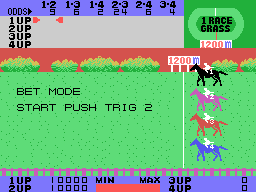
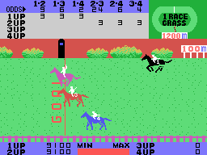

# Las apuestas

En los modos B a E, de uno a cuatro jugadores apuestan a la **pareja** de caballos que llega
primera y segunda, en cualquier orden: 1-2, 1-3, 1-4, 2-3, 2-4 o 3-4. Cada jugador empieza
con 100 puntos, que se ven con dos ceros detrás (10000) abajo de la pantalla, junto a 1UP,
2UP, 3UP y 4UP.

## Las cuotas

Antes de cada carrera el juego echa dieciséis números del 0 al 15, cuatro por caballo
(`azar16`, 0xA97E). Con el primer número de cada caballo hace las **cuotas** de las seis
parejas, en la fila ODDS de arriba (`cuotas`, 0xA1B9):

- el **peso** de una pareja es 31 menos los números de sus dos caballos, al cuadrado;
- cada cuota es el peso de la pareja por un factor, entre la suma de los seis pesos, y nunca
  menos de 2. El factor crece con lo que separa el número más alto del más bajo (0xA2EF).

Ese mismo primer número va a la **fuerza** del caballo para la carrera, con la distancia y el
segundo número (`fuerzas_empieza`, 0xA01C). Así, cuanto más fuertes los dos caballos, menos
paga su pareja.

## Cómo se apuesta

BET MODE: un cursor rojo de dos sprites se mueve por una rejilla de seis columnas, una por
pareja, y una fila por jugador (`apuesta_mueve`, 0xA49A). El botón 1 cambia entre **mover** y
**apostar**; apostando, el cursor parpadea, y cada toque arriba pone un punto a la pareja y
cada toque abajo lo devuelve; si se sostiene, se repite (`apuesta_punto`, 0xA400). Cada
jugador puede apostar a **tres parejas** como mucho, hasta 99 puntos cada una. El botón 2
cierra las apuestas y empieza la carrera.

En el GIF, el jugador 1 apuesta tres puntos a 1-2, 1-3 y 1-4, y el jugador 2 a 2-3, 2-4 y 3-4.

## El pago

Cuando cruzan la meta los dos primeros, la pareja ganadora parpadea en la fila ODDS
(`ganadora_parpadea`, 0xA992) y empieza el pago. No va en la interrupción sino en el bucle
principal (`pago`, 0xA2F5): por cada punto apostado a la pareja ganadora, la cuota se suma
al dinero del jugador, de punto en punto, y el dinero se escribe en la pantalla cada vez. En
el GIF la pareja es la 2-3, a 24: el jugador 2 tenía tres puntos y pasa de 9100 a 16300.

Si a nadie le queda dinero, GAME OVER; después de la carrera 9, RACE END. Si no, PUSH TRIG 2
y la carrera siguiente.

En el modo del jinete, el dinero de 1UP es el premio: 1ST BONUS o 2ND BONUS si su caballo
llega primero o segundo (`premio_jinete`, 0xABCC).
