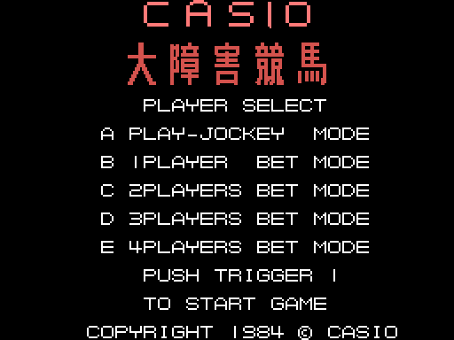
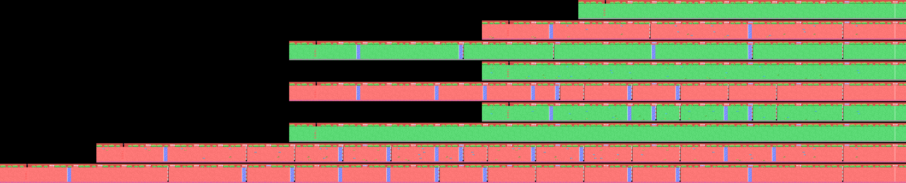
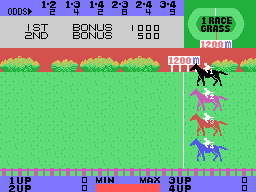
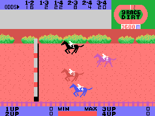
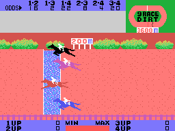
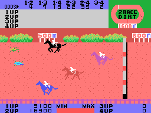
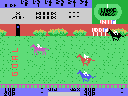

# Las carreras

## La selección

El juego monta SCREEN 2 a mano, con los ocho registros del VDP de 0x8053, y carga todos sus
dibujos de una vez (`carga_dibujos`, 0x83F6): 2 KB de sprites, 2 KB de casillas y sus
colores. La selección se monta en la RAM al arrancar (`seleccion_monta`, 0x84AA): CASIO y
大障害競馬 en letras grandes, los cinco modos y el copyright.

Esta pantalla sale de **ejecutar la ROM** con `tools/pantallas.py` (el Z80 de
`tools/z80run.py` con las rutinas de la BIOS que usa el juego, escritas a mano en
`tools/bios.py`), y es idéntica a la VRAM que grabó openMSX: **0 píxeles distintos** de
49 152. La pantalla de la carrera, en [La partida](LA-PARTIDA.html), es un cuadro grabado en
openMSX: el suelo y las cuotas se echan al azar con el registro R del Z80 (`azar`, 0x8636),
y no hay dos carreras iguales.

## La pista

La pista son doce filas de suelo con casillas elegidas al azar (`suelo_azar`, 0x901C), una
fila de arbustos y carteles de distancia encima y una valla abajo. Está en la RAM (0xED00) y
**corre una casilla entera a la derecha** (ocho píxeles) cada vez que su cuenta (0xE06F) pasa
de 16: todo se mueve un byte y por la izquierda entra una columna nueva con sus arbustos y su
obstáculo (`pista_corre`, 0x90F9). Cada cinco columnas son un paso de 25 metros.

La pista va **a la velocidad del caballo que va delante**: cuando un caballo llega al borde
izquierdo de la pantalla, la pista toma su velocidad, y luego se va frenando poco a poco
(`camara`, 0x9627). Cada caballo se mueve en la pantalla por la diferencia entre su velocidad
y la de la pista.

En el óvalo de arriba a la derecha, **cuatro puntos** dan la vuelta con los caballos
(`plano`, 0xA6E3): las dos rectas y las dos curvas son tablas de coordenadas (0xA7BC).

## Las nueve pistas enteras

Las nueve carreras de la salida (a la derecha) a la meta (a la izquierda), como se ven correr, a la mitad de tamaño:
de 1.200 a 3.600 metros, 240 a 720 columnas más las 32 de la salida. Están **pintadas ejecutando la ROM**
(`tools/pistas.py`): `pista_monta` (0x8D7D) monta la salida y después, una y otra vez, la parte de `pista_corre`
que corre la pista una casilla (0x911A) y mete cada cinco columnas el paso siguiente, hasta el último (0xBB). El
**suelo** lo echa el juego al azar con el registro R (`suelo_azar`, 0x901C): el de la imagen es el de esta ejecución,
como el de una carrera cualquiera; los arbustos, los carteles, la valla de abajo y los obstáculos son los de cada
carrera.

Cotejo con la demostración grabada (la carrera 9, desde la salida): las filas de los arbustos y los carteles y la de
la valla salen **iguales** a la RAM de la pista del juego; las del suelo no, porque son al azar.

## La salida

La fanfarria, el sonido de la salida, y los caballos arrancan (`carrera_sale`, 0x8B0B).
Mientras corren, el canal 0 del motor de sonido toca el **galope**: tres golpes de ruido que
se repiten sin fin.

## El salto

El salto es una serie de dibujos del caballo (0x9A20): sube, se queda 24 cuadros en el aire y
baja (`caballo_salta`, 0x9B98). El jinete es un sprite aparte, con el número del caballo, y
sube y baja con el galope.

## La caída

Un caballo que pisa el agua o una valla **cae**: en el cuarto paso de la caída el jinete sale
volando por una trayectoria de ocho puntos (0x9E7F), el caballo se queda en el suelo y la
pista lo lleva hacia atrás. En el borde derecho el jinete vuelve a montar y el caballo sigue
(`suelo_atras`, 0x9C87).

## La mata

En las carreras pares hay **matas** en el suelo, puestas al azar de dos en dos. Un caballo
que pisa una **tropieza**: se frena 24 cuadros y sigue (`frenazo`, 0x9B4A).

## La meta

El poste de la meta lleva GOAL escrito de arriba abajo. El primer caballo que la cruza pasa
a todos los demás al último estado, correr hasta salir de la pantalla
(`caballo_tras_meta`, 0x9CD3); la luz de lo alto del poste se pone blanca ocho cuadros en
cada llegada (`meta_luz`, 0x9EAD). Los dos primeros hacen la **pareja ganadora**
(`meta_puesto`, 0x97F8): cada caballo suma un valor (0x10, 0x12, 0x14, 0x18) y la suma de los
dos da la pareja (0x9865). En el modo del jinete, sus números van al recuadro junto a 1ST y
2ND.
