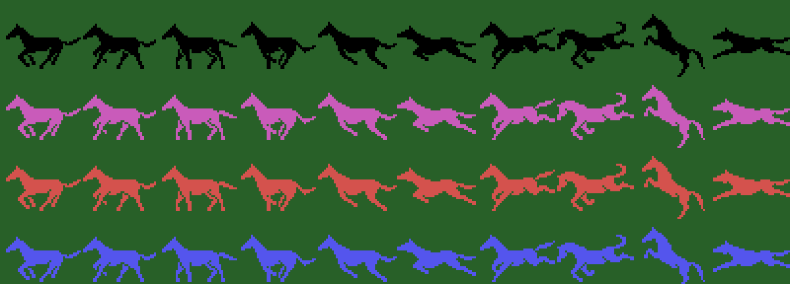
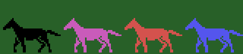
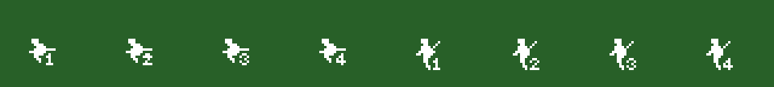

# Los sprites

Todo lo de esta p&aacute;gina est&aacute; **montado desde las tablas de la ROM** con `tools/hojas.py`. Ninguna imagen
es una captura.

**Cotejado con openMSX** en las grabaciones de la web: la tabla de dibujos de los sprites (VRAM 0x3800-0x3FFF) es
**id&eacute;ntica** a los 2 KB de 0xAC1B en 44.335 cuadros (los 5 restantes, mientras se carga), y los tres sprites de
cada caballo casan con la copia de la tabla de sprites del juego en **62.625 cuadros**: en 62.465 con el estado de ese
cuadro, en 140 con el del anterior (el juego compone y despu&eacute;s cambia el estado), en 18 con la Y movida un punto
despu&eacute;s de componer y en 2 a mitad de un cambio de dibujo.

## El caballo

Diez dibujos de tres sprites (0xB3DB, nueve bytes cada uno: el dibujo, la Y y la X de cada sprite), en los colores de
los cuatro caballos (`caballos`, 0x970B: el 1 negro, el 2 magenta, el 3 rojo oscuro y el 4 azul). Los dibujos de los
sprites son los 2 KB de 0xAC1B, que `carga_dibujos` (0x8402) pone tal cual en 0x3800.

## Las animaciones

Cuatro series de cuatro dibujos (0x9A20), que `tabla_umbral` (0x80BB) recorre un dibujo cada 8 pasos: el **galope**
(2, 3, 0, 1), el **salto** (4, 5, 9, 6), la **ca&iacute;da** (8, 5, 7, 2) y **en el suelo** (7, 2, 2, 2). Los pasos
los cuenta `suma_paso` (0x80A3) con la velocidad del caballo; aqu&iacute;, con el paso 0x20 (la velocidad 0x60 de la
tabla de 0x961F), un paso cada dos cuadros y un dibujo cada 16: el galope dos veces, el salto, la ca&iacute;da y en el
suelo.

## El jinete

Blanco (0x9D49), con el n&uacute;mero de su caballo, sentado o con el l&aacute;tigo: los ocho dibujos de 0x9D99, que
llevan tambi&eacute;n su sitio sobre el caballo (sin cotejar: aqu&iacute; van sueltos).

